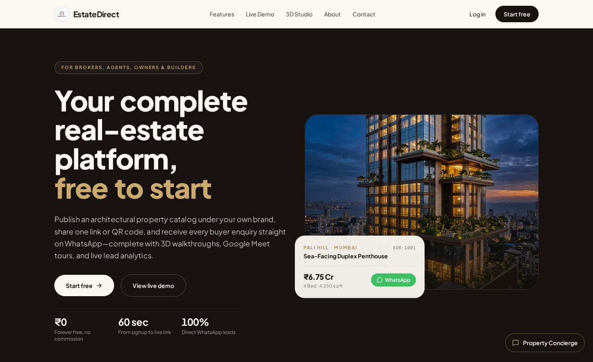

<div align="center">

<h1>
  
  &nbsp;EstateDirect
</h1>

<hr />

<p>
  <a href="#quick-start">
    
  </a>
</p>

<h2>Your complete real-estate platform. Free forever.</h2>

<hr />

<h3>List, verify, tour, book, and close properties directly from your browser.</h3>

<p>Built for builders, brokers, and property owners across Bengaluru &amp; India — zero commissions, zero subscriptions.</p>

<p>
  <a href="#features">Features</a> &middot;
  <a href="#bengaluru-showcase">Bengaluru Portfolio</a> &middot;
  <a href="#quick-start">Quick Start</a> &middot;
  <a href="#deploy-free-no-credit-card">Deploy Free</a> &middot;
  <a href="SECURITY.md">Security</a> &middot;
  <a href="mailto:estatedirect@zohomail.in">Contact</a>
</p>

<p>
  
  
  <a href="LICENSE"></a>
  
  
  
</p>

<br />

<p>
  <a href="#features">
    
  </a>
</p>

</div>

---

## Features

EstateDirect gives independent builders, real-estate consultants, and property owners an end-to-end digital storefront and lead workspace—without paying portal listing fees.

| Capability | What You Get Out of the Box |
| --- | --- |
| **Branded Public Catalog** | Shareable agency storefront (`/agency/:slug`) with category filters by city, locality, property type, RERA status, project stage, and price range. |
| **Builder & Developer Listing Studio** | Add apartments, villas, penthouses, and residential plots with land area, tower/unit counts, possession timelines, construction phases, and approval checkmarks (RERA, BBMP/BDA, A-Khata, OC/CC). |
| **Auto Walkthrough Demo Video** | Upload property photos and generate an instant narrated slideshow walkthrough right inside the listing viewer—no external video editor needed. |
| **Direct WhatsApp Lead Routing** | One-click WhatsApp buyer handoff pre-filled with property code, locality, and price, paired with built-in lead tracking. |
| **Google Calendar, Gmail & Meet Tours** | Schedule physical site visits or instant Google Meet virtual tours and automatically notify the registered agency email (`estatedirect@zohomail.in` or your own). |
| **Passwordless Email OTP & OAuth** | Free 6-digit Email OTP login (powered by Zoho Mail SMTP), plus optional Google and GitHub sign-in. |
| **Built-In SEO & Web Analytics** | Automatic OpenGraph cards, Twitter metadata, Schema.org JSON-LD (`WebApplication`, `RealEstateListing`, `FAQPage`), `/robots.txt`, `/sitemap.xml`, and live traffic analytics dashboard. |

---

## Bengaluru Showcase

Includes a one-click **Bangalore Luxury Portfolio Seeder** covering 5 representative high-end developments:

1. **The Verandah at 12th Main** — 4 BHK Luxury Sky Apartments, Indiranagar *(RERA Approved · Nearing Possession)*
2. **Palm Grove Courtyard Villas** — 4 BHK Independent Villas, Whitefield *(RERA Approved · Under Construction)*
3. **The Banyan Reserve** — 5 BHK Duplex Sanctuary Penthouse, Sadashivanagar *(RERA Approved · Ready to Move)*
4. **Elysian Terraces** — 3 BHK Corner Residences, Koramangala 3rd Block *(RERA Approved · New Launch)*
5. **Devanahalli Heritage Estates** — Pre-Launch Freehold Villa Plots, IVC Road *(K-RERA Filed · Upcoming)*

---

## Tech Stack

- **Frontend:** React 19, TypeScript (strict), Tailwind CSS v4, React Router, Lucide Icons, Vite
- **Backend:** Express (`server.ts`), Nodemailer (Zoho Mail SMTP), Google Calendar / Gmail / Meet proxy routes, Gemini AI brochure/copy helper
- **Database & Auth (Optional):** Firebase Auth & Firestore (with strict tenant-isolated `firestore.rules`) — also runs 100% standalone with Email OTP + browser persistence when Firebase env vars are omitted
- **Testing:** Built-in `node:test` unit test suite covering pricing, RERA/stage filtering, SEO metadata, analytics, and property seeding

---

## Quick Start

### Prerequisites

- **Node.js 20+** and **npm**

### Run Locally

```bash
# 1. Clone the repository
git clone https://github.com/vishalmadargaon/EstateDirect.git
cd EstateDirect

# 2. Install dependencies
npm install

# 3. Copy the safe environment template (no secrets committed in repo)
cp .env.example .env

# 4. Start the full-stack dev server on http://localhost:3000
npm run dev
```

### Verification Commands

```bash
npm test                                                         # Run unit tests
npx tsc --noEmit --strict --noUnusedLocals --noUnusedParameters  # Strict TypeScript check
npm run lint                                                     # Lint codebase
npm run build                                                    # Build production bundle
```

---

## Environment Variables

All credentials are configured strictly via environment variables—**never commit real keys into the repository**. See [`.env.example`](.env.example) for the complete list:

| Variable | Scope | Purpose |
| --- | --- | --- |
| `SMTP_HOST`, `SMTP_PORT`, `SMTP_SECURE`, `SMTP_USER`, `SMTP_PASS`, `SMTP_FROM` | Server only | Live Email OTP codes, site-visit booking alerts, and Contact Us delivery via Zoho Mail SMTP |
| `BUSINESS_CONTACT_EMAIL` | Server only | Registered agency inbox (defaults to `estatedirect@zohomail.in`) |
| `GEMINI_API_KEY` | Server only | Optional AI-assisted listing description & brochure summary generation |
| `VITE_GA_MEASUREMENT_ID` | Client (public) | Optional Google Analytics 4 measurement ID (`G-XXXXXXXXXX`) |
| `VITE_FIREBASE_*` | Client (public) | Optional Firebase Web SDK config to enable Google/GitHub Sign-In and Firestore cloud sync |

---

## Deploy Free (No Credit Card)

EstateDirect includes a pre-configured [`render.yaml`](render.yaml) blueprint and a full click-by-click **[Render + Zoho Mail + GA4 + Search Console Go-Live Guide](DEPLOYMENT.md)** for **free hosting on Render**:

1. Push this repository to your GitHub account.
2. Go to [render.com](https://render.com) → **New +** → **Blueprint** and connect `vishalmadargaon/EstateDirect`.
3. Render automatically reads `render.yaml` (`plan: free`, `npm install --include=dev && npm run build`, `npm start`, health check `/healthz`).
4. Add your private secrets (`SMTP_PASS`, `VITE_GA_MEASUREMENT_ID`, `GOOGLE_SITE_VERIFICATION`) inside Render's **Environment** panel.
5. Click **Apply** to publish your live HTTPS site at `https://estatedirect.onrender.com` — see [`DEPLOYMENT.md`](DEPLOYMENT.md) for the complete walkthrough.

---

## Community & Support

- **Business & Support Email:** [estatedirect@zohomail.in](mailto:estatedirect@zohomail.in)
- **Contributing Guidelines:** [CONTRIBUTING.md](CONTRIBUTING.md)
- **Code of Conduct:** [CODE_OF_CONDUCT.md](CODE_OF_CONDUCT.md)
- **Security Policy:** [SECURITY.md](SECURITY.md)

---

## License

Released under the **[MIT License](LICENSE)** — free for personal and commercial use.

Copyright &copy; 2026 **Vishal Madargaon (EstateDirect)**.
